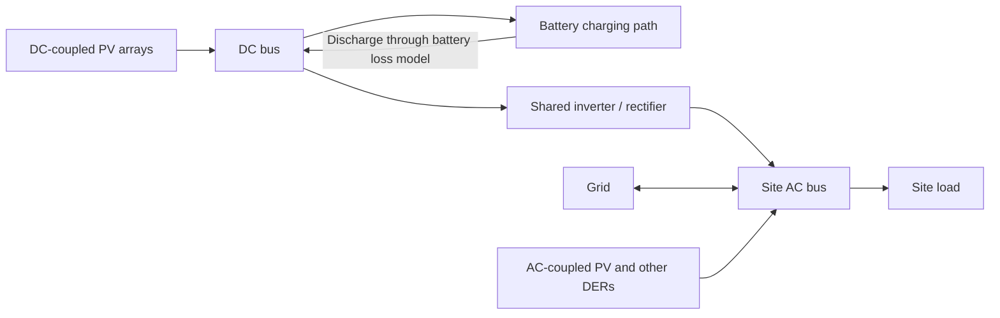

# DC-Coupled PV and Battery: Modeling Approach and Review Questions

Prepared from implementation notes, the task checklist, repository-wide DC-coupling call sites, and relevant branch history. Code reference: `dc-couple`, commit `a88441901`.

**Status caveat:** The notes describe a more complete formulation than the current branch tip. Several changes were disabled for debugging and remain disabled. The meeting narrative below describes the intended approach; the final section identifies what the checked-out code actually does. It should not be presented as a validated, finished capability.

## Meeting Narrative

> I am extending REopt's capacity-expansion and dispatch optimization to represent PV and a battery sharing a DC bus and inverter, while retaining the option to have other AC-coupled PV at the same site.
>
> The central change is to distinguish power on the DC side from power at the site's AC interface. PV can charge the battery directly without passing through an AC conversion, or bypass the battery and supply the shared inverter. Battery losses apply only to energy stored; inverter losses apply to power crossing the AC/DC boundary.
>
> I retain AC units for grid purchases, grid exports, grid-to-battery charging, and battery discharge delivered to the AC system. DC-coupled PV production, charging, and curtailment are intended to be expressed on the DC side. Technology sets distinguish AC- and DC-coupled sources, so multiple PV arrays can use different coupling arrangements.
>
> The intended sizing formulation optimizes PV DC nameplate capacity, battery energy and power capacity, and shared-inverter AC capacity. The inverter must accommodate the combined flow crossing the converter, not the sum of each component's nameplate rating. I want feedback on whether that dispatch-based inverter sizing is sufficient, and what hardware or operating limits should supplement it.
>
> My initial topology restricts battery charging to DC-coupled PV. Grid charging and charging from other AC-connected resources are separate design decisions rather than automatically implied capabilities. The same physical model should apply in normal operation and modeled outages.
>
> For costs, my proposed approach is to reuse the battery's per-kW cost input for the shared inverter and retain a per-kWh battery cost. That needs a careful review of cost boundaries, particularly whether PV costs still include a separate inverter and whether battery power hardware needs its own cost.

## Physical Topology

The diagram shows the baseline PV-to-battery and DC-to-AC paths. Reverse conversion from the AC bus to the DC bus is an optional extension, not an assumed baseline capability. PV can flow from the DC bus to the inverter without entering the battery.

## Main Modeling Decisions

### 1. Separate the Electrical Boundaries, Not the Entire Optimization

The approach extends existing REopt variables, technology sets, and constraints rather than building a separate DC-system optimizer. A per-PV coupling flag allows a subset of arrays to share the battery's DC bus; other PV and electric technologies remain AC-connected.

| Quantity | Intended electrical basis |
| --- | --- |
| PV installed capacity | DC nameplate, for both AC- and DC-coupled PV |
| DC-coupled PV production, curtailment, and PV-to-battery flow | DC power |
| AC-coupled PV production and PV-to-battery flow | AC power |
| Grid purchase, grid export, and grid-to-storage flow | AC power |
| Battery discharge supplied to the site | AC power, after applicable losses |
| Battery power capacity | DC for the DC-coupled battery; requires explicit output documentation |
| Battery energy capacity and state of charge | Stored-energy basis, not AC-delivered energy |
| Shared inverter capacity | AC rating, according to the later checklist decision |

An important distinction: PV capacity was already DC-rated in REopt. Selecting a DC production profile changes the dispatch energy boundary, not the meaning of PV nameplate capacity.

### 2. Model Losses Along the Actual Energy Path

The intended DC PV resource is the PVWatts **DC output**, normalized to PV DC capacity. Array losses remain relevant. Inverter conversion is then modeled in REopt using the storage/shared-inverter parameters rather than the individual PV inverter efficiency.

Direct PV-to-battery charging should incur the battery-side charging loss without an AC rectifier loss. Stored energy later discharged to the AC bus should incur both battery-side discharge loss and inverter loss. PV sent directly to the AC bus incurs inverter loss but no battery loss.

The existing battery model divides its internal round-trip efficiency between charging and discharging using square-root factors. This is a constant-efficiency energy model, not a detailed voltage, MPPT, converter-efficiency-curve, or electrochemical model.

The intended principle is to apply conversion losses to the **net flow crossing the shared converter**. Direct DC charging should not be counted as power traversing the inverter. If AC-side charging is allowed, the treatment of opposite-direction flows and inverter versus rectifier efficiency needs an explicit formulation.

`dc_ac_ratio` should not be described as simply multiplying the PV profile. In this code it is passed to PVWatts. The intended relationship among PVWatts' DC output, clipping, and an independently optimized inverter needs confirmation before claiming clipping recovery or a particular DC/AC ratio constraint.

### 3. Size the Shared Inverter From Feasible Dispatch

The proposed inverter-capacity variable is bounded below by AC-side converter throughput at every modeled time step, including modeled outages. With a positive capacity cost, optimization can select the smallest rating consistent with those dispatches.

This decouples three capacities that have different roles: PV DC capacity, battery power capacity, and the inverter's AC rating. PV plus battery can exceed inverter nameplate in aggregate, provided actual converter throughput stays within its rating and excess PV can be stored or curtailed.

This is an operationally optimized size, not automatically a rating that supports every possible future dispatch. Explicit minimum ratings, loading ratios, reserve headroom, or hardware compatibility constraints may be appropriate. Separate directional limits may also be needed if inverter and rectifier ratings differ.

### 4. Make Charging Eligibility a Topology Choice

Technology sets allow DC-coupled PV to charge the battery while excluding AC-coupled PV, generators, and other AC sources from that path. Coexisting AC PV can still supply site load or export.

The notes propose disabling grid charging by default for a DC-coupled battery. Defaulting an option to false is not equivalent to forbidding it: if users can enable grid charging, the reverse-conversion physics, capacity limit, and energy accounting must work. Multiple batteries would additionally require explicit source-to-storage connectivity, rather than only a site-wide AC/DC technology split.

PV export should remain AC-metered. A dedicated battery-to-grid dispatch capability is a separate extension; it should not be implied merely because PV can export.

### 5. Carry the Same Boundaries Into Economics and Accounting

The intended economic simplification is to apply the existing storage per-kW cost to shared-inverter capacity and the per-kWh cost to battery energy, carrying that interpretation through capital cost, replacement cost, financial results, and pro forma calculations.

That simplification needs defensible equipment boundaries. Standard PV costs may already include an inverter; battery power electronics and DC/DC conversion may not be represented by the energy cost alone. Reusing AC-coupled defaults without adjustment can obscure the economics of the topology comparison.

Renewable electricity, production incentives, emissions, and reported energy should use consistent boundaries. For example, an AC-metered export cannot be subtracted directly from a DC energy balance without conversion. Emissions based on grid purchases and exports generally inherit the correctness of the dispatch balance; they do not necessarily need a separate DC emissions factor.

## Questions for High-Level Feedback

1. **Topology:** Is one shared DC bus and inverter with PV-only battery charging a useful initial scope? Should grid charging or charging from AC DERs be supported from the start?
2. **Converter physics:** Are constant directional efficiencies adequate? What restrictions are needed to avoid infeasible opposite-direction operation or artificial charge/discharge loops?
3. **Resource and clipping:** Should we use the pre-inverter PVWatts DC resource and let REopt's shared-inverter limit determine clipping and storage diversion? What role should the existing `dc_ac_ratio` input retain?
4. **Sizing:** Is inverter capacity based on optimized annual and outage dispatch sufficient, or should sizing include nameplate relationships, headroom, or non-optimized future operations?
5. **Battery power hardware:** What DC battery power and DC/DC converter limits, efficiencies, and costs must be represented separately from the shared AC inverter?
6. **Costs:** Can existing per-kW and per-kWh cost inputs be reassigned cleanly, or are separate PV-array, battery-power, and inverter cost inputs needed to avoid double counting or omitted costs?
7. **Resilience:** What additional requirements are needed for grid-forming operation, black start, inverter availability, and shared-component failure? Applying outage energy balances alone does not establish these capabilities.
8. **Validation:** What small benchmark systems or measured data would establish that energy conservation, clipping recovery, topology restrictions, and optimized capacities are physically credible?

## Suggested Meeting Flow

- Open with the meeting narrative and topology diagram.
- Walk through three paths: PV directly to load, PV into storage, and stored energy back to load.
- Explain why PV, battery power, and inverter capacity are separate sizing decisions.
- Discuss the resource/clipping and equipment-cost boundaries first; these strongly affect the comparison with AC coupling.
- Close by agreeing on a minimal validated topology and the next benchmark cases.

## Current Branch: Evidence and Caveats

These observations describe the checked-out code, not every completed item in the supplied checklist. No solver runs were performed for this review.

| Area | Verified behavior at the branch tip |
| --- | --- |
| Input and technology sets | `PV.dc_coupled_with_storage` exists and defaults to false; PV arrays are partitioned into AC/DC sets. See [PV inputs](../src/core/pv.jl#L47) and [technology sets](../src/core/techs.jl#L63). |
| PV resource | PVWatts selects `"ac"` for both coupling modes. The warning that PV inverter efficiency is ignored is not consistent with this active resource path. See [profile selection](../src/core/utils.jl#L471) and [warning](../src/core/pv.jl#L151). |
| Storage losses | DC charging/discharging efficiency fields still exist, but regular state-of-charge constraints use the AC charge efficiency for both technology sets. See [storage defaults](../src/core/energy_storage/electric_storage.jl#L194) and [dispatch](../src/constraints/storage_constraints.jl#L54). |
| AC interface | AC/DC production terms are separated structurally, but DC terms currently have no inverter-efficiency multiplier in load balance or production limits. See [load balance](../src/constraints/load_balance.jl#L8) and [production limits](../src/constraints/load_balance.jl#L94). |
| Shared inverter | Variable declaration, regular/outage capacity constraints, and result extraction are commented out. See [variable](../src/core/reopt.jl#L613), [regular constraints](../src/constraints/storage_constraints.jl#L106), [outage constraints](../src/constraints/outage_constraints.jl#L393), and [results](../src/results/electric_storage.jl#L26). |
| Costs and storage input | Active storage costs retain the battery-power/energy basis. The inspected storage struct has no `dc_coupled` input or AC/DC storage sets implementing the later checklist design. See [storage struct](../src/core/energy_storage/electric_storage.jl#L219) and [model construction](../src/core/reopt.jl). |
| Charging restrictions | Regular-operation AC-source-to-battery restrictions are active when DC PV exists. The storage default still permits grid charging for grid-connected runs; the example turns it off explicitly. See [charging restrictions](../src/constraints/storage_constraints.jl#L127), [default](../src/core/energy_storage/electric_storage.jl#L186), and [example](../test/scenarios/ac_dc_pvs.json#L28). |
| Renewable accounting | This calculation does apply DC battery efficiencies and inverter conversion, unlike the active dispatch equations. Its physical consistency therefore needs reconciliation, not a claim of completed validation. See [renewable accounting](../src/constraints/renewable_energy_constraints.jl#L62). |
| Outputs and incentives | PV results and production incentives use production without a DC-specific inverter conversion. Their intended units/metering basis need to be restored or documented with the full formulation. See [PV results](../src/results/pv.jl#L64) and [incentives](../src/constraints/production_incentive_constraints.jl#L18). |
| Outages | Outage state of charge uses AC efficiency. The AC charging restriction references `p.s.techs` rather than `p.techs` and only loops over `min_resil_time_steps`; this needs inspection before claiming equivalent outage behavior. See [outage SOC](../src/constraints/outage_constraints.jl#L287) and [restriction](../src/constraints/outage_constraints.jl#L406). |
| Multinode | The coupling constraint is called with a node suffix, but its active variable fix does not use that suffix. Treat multinode compatibility as unverified. See [caller](../src/core/reopt_multinode.jl#L128) and [variable fix](../src/constraints/storage_constraints.jl#L131). |
| Regression example | The AC/DC example currently enables no DC PV. Its inverter-size assertion is commented out, and it lives in the debugging tests. Saved historical outputs are not proof that the current DC formulation is tested. See [scenario](../test/scenarios/ac_dc_pvs.json#L33) and [assertions](../test/debugging_tests.jl#L66). |

### Why the Notes and Code Differ

- Commit `74ccb01ad` explicitly substituted the AC PVWatts profile and AC charging efficiency for the DC versions as a temporary test step. Those substitutions are still visible.
- Commit `ae497da0b` commented out shared-inverter sizing and its output.
- Commit `273116a99` removed DC coupling from the example scenario.
- Other checked-off items, including a storage coupling input, AC/DC storage sets, renamed efficiencies, inverter-based costs, and capability guards/warnings, were not found in this checked-out implementation. They may belong to another development state; this review does not establish where.

### Validation to Establish Before Demonstrating Results

- A lossless, unclipped equivalence case comparing AC and DC configurations with identical resource input and matching connectivity restrictions.
- Hand-checkable energy balances for direct PV delivery, DC charging, battery discharge, and optional AC charging, with different inverter and rectifier efficiencies.
- A PV peak above inverter rating to verify storage diversion, export conversion, and curtailment without double counting.
- A mixed AC/DC PV case proving prohibited charging flows are zero, both during normal operation and across the complete modeled outage horizon.
- Separate checks of battery power limits and shared-inverter throughput, including simultaneous PV production and battery discharge.
- Financial reconciliation showing that each inverter and battery hardware cost is counted once, with consistent replacement treatment.
- Renewable-energy and output reconciliation at documented AC/DC boundaries; production-incentive metering should match the chosen policy.

Multiple electric-storage systems, MPC, off-grid operating reserves, degradation interactions, standalone outage simulation/ERP, and API integration should remain explicitly unvalidated or out of scope until the intended implementation and focused tests are available. Repository call sites alone do not establish support for those workflows.